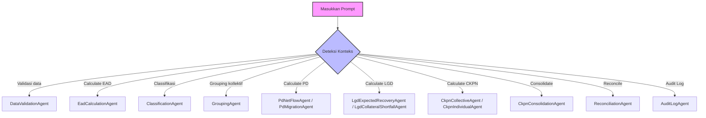

# AGENTS.md – Autonomous Agent & AI Engineering Specifications

**Dokumen:** Agent Architecture, Role Definition & AI Execution Protocol  
**Sistem:** CKPN Calculator BPRS  
**Versi:** 3.0  
**Tanggal:** 22 October 2026  
**Basis:** TASK.md v3.1 + CKPN.md v3.0 + Quality, Safety, Token-Efficiency & Protocol Standards  

---

## 0. Mandatory AI Prompt Execution Protocol (BLOCKING)

Setiap agen AI (termasuk Assistant IDE) yang menangani tugas di repository ini WAJIB menjalankan 4 tahap secara disiplin sebelum dan sesudah menyentuh kode:

```
[Prompt Diterima]
       │
       ▼
1. UNDERSTAND CONTEXT & AUDIT CODE
   ├── Pahami intent bisnis & regulasi PSAK 414/CKPN
   ├── Periksa kode terkait (gunakan Read/Grep, dilarang modifikasi sebelum membaca)
   └── Temukan gap, bug, inefisiensi, risiko regresi, atau missing boundary validation
       │
       ▼
2. AUTOMATIC SKILL SELECTION
   ├── Analisis konteks tugas & mapping ke skill yang tersedia secara instan
   │   ├── Laravel / Eloquent / Controller  → skill: laravel-best-practices / spatie-laravel-php
   │   ├── Query, Indexing, N+1, DB Opt     → skill: laravel-database-optimization
   │   ├── Keamanan, Auth, Upload, SQLi     → skill: laravel-owasp-security / spatie-security
   │   ├── Testing, Pest PHP, Unit/Feature  → skill: laravel-testing
   │   ├── UI / Styling / Tailwind CSS      → skill: tailwind-best-practices / tailwindcss-development
   │   ├── UI/UX Design System / Pro-Max   → skill: ui-ux-pro-max / ui-styling
   │   └── Token Saver / Refactoring lean   → skill: ponytail / token-saver
   └── Panggil tool `Skill` SEGERA sebagai aksi pertama jika ada skill yang relevan
       │
       ▼
3. FORMULATE PLAN & EXECUTE (Safe, Usable, Token-Efficient)
   ├── Rancang langkah perbaikan terstruktur (gunakan TodoWrite jika ≥ 3 langkah)
   ├── Tulis kode dengan prinsip:
   │   ├── YAGNI & Native First: Jangan over-engineer, utamakan native PHP/Laravel features
   │   ├── Safe by Default: Validasi trust boundaries, batasi range, hindari data corruption
   │   ├── Usable & Clean: Standar PSR-12, bebas dari "AI slop" visual/kode tanpa tujuan
   │   └── Token-Efficient: Diff sesingkat mungkin, hindari query N+1 & multiple loop O(n²)
   └── Verifikasi integritas logika atau jalankan tests yang relevan
       │
       ▼
4. LOG CHANGE TO CHANGELOG.md (MANDATORY)
   └── Setiap selesai mengeksekusi prompt/perubahan, catat ringkasan pekerjaan di `CHANGELOG.md`
```

---

## 1. Principles of Code Standards & Usability

1. **Anti-Slop Architecture & UI:**
   - Dilarang membuat visual "AI slop" (gradient glossy berlebih, animasi hover tidak fungsional, nested card tanpa fungsi, padding/margin arbitrer).
   - Gunakan enterprise design system yang bersih: palet netral berbobot, border halus (border-gray-200), kontras terbaca jelas (WCAG AA), tabular numbers font mono untuk data keuangan/nominal.
   - Hindari abstraksi fiktif/prematur: satu class implementasi tidak butuh interface khusus kecuali diminta, jangan bikin repository pattern berlebihan jika Eloquent scope sudah cukup.

2. **Safety & Zero-Data-Corruption Guarantee:**
   - Semua operasi multi-table atau multi-stage WAJIB dibungkus `DB::transaction()`.
   - Angka desimal keuangan/nominal CKPN WAJIB diproses dengan akurasi presisi (`bcmath` atau casting `decimal:2` / `decimal:4`), dilarang pembulatan floating-point float PHP yang tidak terkontrol.
   - Guard boundary validation: EAD ≥ 0, 0 ≤ PD ≤ 1, 0 ≤ LGD ≤ 1, CKPN ≤ EAD.

3. **Token & Performance Optimization:**
   - Eager-load relasi (`with()`) untuk mencegah N+1 queries.
   - Selalu `select()` kolom yang dibutuhkan pada tabel besar (snapshot, financing, audit).
   - Gunakan single-pass accumulator daripada filter berulang di memory collection.
   - Gunakan `chunkById()` atau stream untuk batch processing pembiayaan berukuran besar.

---

## Overview

Agent adalah autonomous service/job yang menjalankan proses bisnis terstruktur tanpa intervensi manual. Setiap agent bertanggung jawab untuk satu tahap calculation pipeline dengan input validation, error handling, audit logging, dan result persistence.

**Design Principle:**
- Single Responsibility: one agent = one calculation stage
- Idempotency: re-run same input → same output
- Immutability: result snapshot tidak berubah post-completion
- Traceability: semua action logged di audit trail
- Resilience: graceful error handling, no data corruption
- **Efficiency**: kode ringan, minimal token, menghindari komputasi berlebihan
- **Usability**: output konsisten, well-documented, easy to debug
- **Safety**: input validation rigorous, output validated, edge cases handled

---

## Agent Registry Enhancements

### General Agent Guidelines (Added)

**Token Efficiency:**
- Gunakan data structures yang optimal (hindari nested loops yang dieksekusi berulang)
- Cache results yang sering diakses, jangan fetch ulang dari DB per record
- Gunakan select fields saja, jangan `SELECT *`
- Batched processing untuk batch yang besar (>100 records)
- Early exit dari loop saat error critical ditemukan (tapi tetap log warning non-blocking)

**Code Standards:**
- Konvensi nama: snake_case untuk variable DB, camelCase untuk JSON output
- Setiap output JSON harus memiliki field yang konsisten: `status`, `count`, `data`/`details`
- Error messages harus actionable: nama field, rule yang di violate, expected value
- Gunakan constants untuk nilai magic (threshold, tolerance, default values)
- Documentasi setiap transformasi data dalam komentar kode

**Safety by Default:**
- Validate semua input sebelum proses
- Sanitize strings: trim whitespace, uppercase codes, convert date formats
- Boundary checks: pastikan hasil tidak negative kecuali jika intentionally
- Default values yang jelas saat data missing (bukan `null` tak terduga)
- Audit trail harus lengkap untuk setiap operasi write

---

### 1. DataValidationAgent

**Purpose:** Validasi & normalize data sebelum calculation

**Token Efficiency Note:**
- Load validation rules sekali dari DB, cache dalam memory selama calculation run
- Iterate batch dengan forward iteration saja, hindari recursion yang tidak perlu
- Flag error records dalam single pass, collect messages array sekaligus

**Process:**
1. Load validation rules dari database (cached per run)
2. Iterate batch, check setiap record (single pass):
   - Field presence: semua required field ada
   - Data type: string, date, decimal format correct
   - Referential integrity: office_code, collateral_type, product_code exist di master
   - Business rule: outstanding_balance >= 0, principal_arrears >= 0, effective_date <= expired_date
3. Flag error records, collect error messages
4. Normalize: trim whitespace, uppercase code, convert yyyymmdd → date format
5. Persist normalized data ke financing table
6. Create validation_report dengan pass/fail/warning status

**Output:**
- validated_record_count: integer
- error_record_count: integer
- warning_record_count: integer
- validation_report: JSON array dengan error detail per record
- audit_log: action log dengan user, timestamp, status

**Error Handling:**
- Validation fail → stop batch, log error, don't persist
- Warning (non-blocking) → allow persist with warning flag
- Partial failure → allow re-validate subset (idempotent)

**Database:**
- Read: import_staging, master tables (office, collateral_setup, usage_types)
- Write: financing, snapshot, validation_report, audit_log
- Transaction: ACID, rollback on critical error

**Acceptance Criteria:**
- [ ] 100% record validated
- [ ] Error message actionable (field name, rule violated, expected value)
- [ ] Date format conversion correct (yyyymmdd → YYYY-MM-DD)
- [ ] Referential integrity enforced (no orphan records)

---

### 2. EadCalculationAgent

**Purpose:** Calculate Exposure at Default per akad strategy

**Token Efficiency Note:**
- Load EAD rules sekali, gunakan lookup table dalam memory
- Validate batching: process 50 records per query untuk menghindari memory limit
- Early termination saat assessment_date future (skip sisa batch)

**Input:**
- calculation_run_id
- assessment_period_id
- assessment_date (yyyymmdd)
- financing data (loan_number, product_code, outstanding_balance, principal_arrears, effective_date, expired_date, active_flag, write_off_flag)
- EAD rule per product_code dari database

**Process:**
1. Load EAD rules untuk masing-masing product_code aktif pada assessment_date (cached lookup)
2. Load financing & snapshot data per calculation_run_id
3. Iterate financing, apply rule (single pass):
   ``` 
   IF product_code = MURABAHAH THEN ead = outstanding_balance
   IF product_code = MULTIJASA THEN ead = outstanding_balance
   IF product_code = MUSYARAKAH AND expired_date <= assessment_date THEN ead = principal_arrears ELSE ead = 0
   IF product_code = IMBT AND expired_date <= assessment_date THEN ead = principal_arrears ELSE ead = 0
   ```
4. Validate: ead >= 0, ead <= outstanding_balance + principal_arrears
5. Persist hasil ke financing_ead_snapshot dengan ead_calculated, ead_rule_applied, assessment_date
6. Generate reconciliation: compare ead_calculated vs source outstanding_balance
7. Log mismatch jika difference > tolerance (0.01%)

**Output:**
- ead_snapshot JSON: {loan_number, ead_calculated, ead_rule_applied, outstanding_balance, principal_arrears, ead_variance}
- total_ead_calculated: Decimal (sum semua ead)
- total_ead_variance: Decimal (sum variance)
- reconciliation_status: PASS | FAIL | WARNING
- audit_log: action, count, status

**Error Handling:**
- Invalid product_code → skip record, log warning
- Missing EAD rule → use default rule (outstanding_balance), log exception
- Negative EAD result → set ead = 0, log warning
- Assessment date future → error, stop calculation

**Database:**
- Read: financing, snapshot, ead_rules, assessment_periods
- Write: financing_ead_snapshot, ead_reconciliation_report, audit_log
- Index: financing(loan_number), snapshot(periode_snapshot)

**Acceptance Criteria:**
- [ ] EAD calculated per rule akad correct
- [ ] Result immutable (cannot re-calculate same run)
- [ ] Reconciliation mismatch flagged & logged
- [ ] 100% financing record processed

---

### 3. ClassificationAgent

**Purpose:** Tentukan INDIVIDUAL vs COLLECTIVE per financing

**Token Efficiency Note:**
- Load individual_overrides sekali, gunakan hash set untuk O(1) lookup
- Hitung total_individual dan total_collective dalam single iteration

**Input:**
- calculation_run_id
- assessment_period_id
- financing data + ead_calculated
- individual_classification_rules
- individual_overrides (jika ada)

**Process:**
1. Load classification rules aktif pada assessment_date
2. Load individual_overrides untuk period ini (cached, gunakan array lookup)
3. Iterate financing (single pass):
   ```
   IF loan_number IN (select loan_number from individual_overrides) THEN
     classification = individual_overrides.classification
     reason = override alasan
   ELSE
     IF (ead > threshold_amount) OR (write_off_flag = true) OR (ppka_value > 0) THEN
       classification = INDIVIDUAL
       reason = rule-based
     ELSE
       classification = COLLECTIVE
       reason = rule-based
   ```
4. Persist hasil ke financing_classification dengan classification, reason, applied_rule
5. Count: total_individual, total_collective

**Output:**
- classification_snapshot JSON: {loan_number, classification, reason, applied_rule, ead}
- total_individual_count: integer
- total_collective_count: integer
- audit_log: action, count, status

**Error Handling:**
- Invalid threshold_amount → use default (0), log warning
- Missing override reason → log error, skip override
- Classification unclear → default COLLECTIVE, log warning

**Database:**
- Read: financing, financing_ead_snapshot, individual_classification_rules, individual_overrides
- Write: financing_classification, audit_log
- Transaction: atomic per calculation_run

**Acceptance Criteria:**
- [ ] Classification correct per rule + override
- [ ] Reason traced & logged
- [ ] All financing classified
- [ ] Override audit trail

---

### 4. GroupingAgent

**Purpose:** Build collective groups berdasarkan 3 dimensi (office_code + product_code + usage_code)

**Token Efficiency Note:**
- Gunakan map composite key (office_code + "|" + product_code + "|" + usage_code) untuk grouping
- Hitung count dan sum_ead dalam single pass, hindari grouping berulang

**Input:**
- calculation_run_id
- financing_classification (COLLECTIVE only)
- office master data
- product master data
- usage_code master data

**Process:**
1. Filter financing WHERE classification = COLLECTIVE
2. Group by (office_code, product_code, usage_code) menggunakan map composite key:
   ```
   GROUP BY office_code, product_code, usage_code
   → collective_group_key = "OFFICE_PRODUCT_USAGE"
   → count financing per group
   → sum ead per group
   ```
3. Validate group: count > 0, sum_ead > 0
4. Assign bucket per hari_tunggakan (derived dari principal_arrears & outstanding_balance):
   - Bucket 1: 0 hari (lancar)
   - Bucket 2: 1–30 hari
   - Bucket 3: 31–60 hari
   - Bucket 14: > 360 hari (WO)
5. Persist ke collective_groups dengan group_key, office_code, product_code, usage_code, total_ead, member_count
6. Persist ke collective_group_members (many-to-many relationship)

**Output:**
- collective_groups: array {group_key, office_code, product_code, usage_code, total_ead, member_count, buckets_distribution}
- total_groups_created: integer
- total_collective_ead: Decimal
- audit_log: action, group_count, status

**Error Handling:**
- Empty group after filter → skip group
- Invalid master reference → log error, exclude financing
- Bucket calculation error → use default bucket, log warning

**Database:**
- Read: financing, financing_classification, office, products (master)
- Write: collective_groups, collective_group_members, audit_log
- Index: collective_groups(calculation_run_id, group_key), collective_group_members(group_id)

**Acceptance Criteria:**
- [ ] Grouping 3-dimensi correct
- [ ] All COLLECTIVE financing assigned to group
- [ ] Group member count correct
- [ ] Bucket distribution mapped

---

### 5. PdNetFlowAgent

**Purpose:** Calculate PD (Probability of Default) menggunakan Net Flow method

**Token Efficiency Note:**
- Build transition matrix dalam single pass historical data
- Gunakan accumulator dictionary rather than nested loop untuk hitung transition rate
- Default PD hitung sekali jika insufficient data, hindari per-group recalculation

**Input:**
- calculation_run_id
- collective_groups (dengan member list)
- historical_window_months configuration (default 36)
- assessment_date

**Process:**
1. Load historical financing data untuk window = assessment_date - historical_window_months
2. Build monthly transition matrix per group (single pass):
   ```
   [FROM_BUCKET][TO_BUCKET] = count financing yang migrate
   ```
3. Calculate transition rate:
   ```
   transition_rate[i][j] = count(FROM_BUCKET_i → TO_BUCKET_j) / count(all in BUCKET_i)
   ```
4. Define loss buckets: Bucket >= 7 (90+ hari tunggakan) adalah DEFAULT
5. Calculate PD:
   ```
   PD = sum(transition_rate[i][loss_bucket]) untuk all i
   ```
   Compound jika multi-periode:
   ```
   PD = 1 - (1 - flow_rate_1) × (1 - flow_rate_2) × ...
   ```
6. Validate: 0 <= PD <= 1
7. Persist hasil ke pd_netflow_results

**Output:**
- pd_snapshot JSON: {group_key, pd_calculated, transition_matrix, flow_rate, periods_analyzed}
- total_groups_calculated: integer
- average_pd: Decimal
- audit_log: action, window_months, methodology, status

**Error Handling:**
- Insufficient historical data (< 24 months) → use default PD (5%), log warning
- No transition data → use default PD (1%), log warning
- Division by zero (empty from_bucket) → skip bucket, log warning

**Database:**
- Read: collective_groups, collective_group_members, financing (historical), pd_historical_windows config
- Write: pd_netflow_results, pd_netflow_transitions (detail), audit_log
- Index: financing(office_code, product_code, periode_snapshot)

**Acceptance Criteria:**
- [ ] Transition matrix built correctly
- [ ] PD calculated per group
- [ ] Historical window respected
- [ ] Warning logged jika insufficient data
- [ ] Result bounded [0, 1]

---

### 6. PdMigrationAgent

**Purpose:** Calculate PD menggunakan Migration method (quality rating migration)

**Token Efficiency Note:**
- Load historical rating data sekali, cache di memory
- Build migration matrix dalam single pass, gunakan accumulator pattern

**Input:**
- calculation_run_id
- collective_groups
- historical_window_months configuration
- assessment_date
- write_off_flag, ppka_value dari financing (indicates default/loss)

**Process:**
1. Load historical quality rating migration data (dari financing snapshots dengan rating field)
2. Build 6×6 migration matrix (Rating 1–5 + WO):
   ```
   [FROM_RATING][TO_RATING] = count migrate per periode
   ```
3. Calculate migration rate:
   ```
   migration_rate[i][j] = count(FROM_RATING_i → TO_RATING_j) / count(all in RATING_i)
   ```
4. Define default ratings: Rating 4–5 atau WO adalah DEFAULT state
5. Calculate PD = sum(migration_rate[i→4], migration_rate[i→5], migration_rate[i→WO])
6. Compound multi-periode
7. Persist hasil ke pd_migration_results

**Output:**
- pd_migration_snapshot JSON: {group_key, pd_calculated, migration_matrix, migration_rate, periods_analyzed}
- total_groups_calculated: integer
- average_pd: Decimal
- audit_log: action, methodology, status

**Error Handling:**
- Insufficient rating data → use default PD (5%), log warning
- Rating data missing → skip calculation, log error

**Database:**
- Read: collective_groups, financing (historical dengan rating), pd_migration_config
- Write: pd_migration_results, pd_migration_matrices (detail), audit_log

**Acceptance Criteria:**
- [ ] Migration matrix 6×6 correct
- [ ] PD per group calculated
- [ ] Result bounded [0, 1]

---

### 7. LgdExpectedRecoveryAgent

**Purpose:** Calculate LGD menggunakan Expected Recovery method

**Token Efficiency Note:**
- Load write-off data dalam single query dengan grouping SQL tahun_write_off
- Hitung recovery rate dengan accumulator, hindari per-year recalculation

**Input:**
- calculation_run_id
- collective_groups
- historical_window_months (default 60 months)
- assessment_date
- write_off data + recovery data dari financing snapshots

**Process:**
1. Load write-off data dalam window = assessment_date - 60 months
2. Group write-off by tahun_write_off (SQL GROUP BY, bukan di-app):
   ```
   GROUP BY tahun_write_off
   → total_write_off_balance
   → total_recovery_realized
   ```
3. Calculate recovery rate per tahun:
   ```
   recovery_rate_tahun = total_recovery / total_write_off
   ```
4. Average recovery rate across tahun
5. LGD = 1 - average_recovery_rate
6. Validate: 0 <= LGD <= 1
7. Persist hasil ke lgd_expected_recovery_results

**Output:**
- lgd_er_snapshot JSON: {group_key, lgd_calculated, recovery_rate_by_year, avg_recovery_rate, years_analyzed}
- total_groups_calculated: integer
- average_lgd: Decimal
- audit_log: action, window_months, status

**Error Handling:**
- Zero write-off → LGD = 0 (no loss history), log warning
- Insufficient data (< 5 years) → use default LGD (50%), log warning
- Recovery > write_off → cap recovery_rate = 100%, LGD = 0

**Database:**
- Read: collective_groups, financing (historical dengan write_off_flag & recovery data)
- Write: lgd_expected_recovery_results, lgd_write_offs (snapshot), audit_log

**Acceptance Criteria:**
- [ ] Recovery rate calculated per year
- [ ] LGD = 1 - recovery_rate
- [ ] Default handling jika insufficient data
- [ ] Result bounded [0, 1]

---

### 8. LgdCollateralShortfallAgent

**Purpose:** Calculate LGD menggunakan Collateral Shortfall method

**Token Efficiency Note:**
- Load collateral data dengan LEFT JOIN financing, hindari N+1 queries
- Gunakan SQL aggregate untuk total_shortfall dan total_exposure_writeoff

**Input:**
- calculation_run_id
- collective_groups
- collateral data (loan_number, liquidity_value, estimated_value, valuation_date)
- write_off data dengan collateral execution result

**Process:**
1. Load collateral data per financing (gunai LEFT JOIN, hindari per-record query)
2. Per write-off:
   ```
   outstanding_at_writeoff = outstanding_balance at time of write-off
   net_recovery = liquidity_value - execution_cost (if sold)
   shortfall = MAX(0, outstanding_at_writeoff - net_recovery)
   ```
3. Aggregate per group:
   ```
   GROUP BY group_key
   → total_shortfall = sum(shortfall)
   → total_exposure_writeoff = sum(outstanding_at_writeoff)
   ```
4. LGD = total_shortfall / total_exposure_writeoff
5. Validate: 0 <= LGD <= 1
6. Handle edge case: IF liquidity_value = 0 THEN net_recovery = 0, shortfall = outstanding, LGD = 100%
7. Persist hasil ke lgd_collateral_shortfall_results

**Output:**
- lgd_cs_snapshot JSON: {group_key, lgd_calculated, total_shortfall, total_exposure, collateral_coverage}
- total_groups_calculated: integer
- average_lgd: Decimal
- audit_log: action, status

**Error Handling:**
- Missing collateral data → assume liquidity_value = 0, LGD = 100%
- Negative shortfall → set shortfall = 0, log warning
- Division by zero (zero exposure) → skip group

**Database:**
- Read: collective_groups, collateral, financing (write_off_flag)
- Write: lgd_collateral_shortfall_results, lgd_collateral_details (snapshot), audit_log

**Acceptance Criteria:**
- [ ] Shortfall calculated correct
- [ ] LGD bounded [0, 1]
- [ ] Collateral edge case handled (zero value → 100% LGD)

---

### 9. LgdWeightedAgent

**Purpose:** Aggregate LGD ER + CS → Weighted LGD

**Token Efficiency Note:**
- Load ER dan CS results sekali, gunakan map group_key untuk lookup
- Hitung total_loss_weighted dan total_exposure_weighted dalam single pass

**Input:**
- calculation_run_id
- lgd_expected_recovery_results
- lgd_collateral_shortfall_results
- lgd_calculation_method config (ER | CS | WEIGHTED)

**Process:**
1. Load ER & CS hasil per group (cached lookup via group_key)
2. IF config = ER THEN use only ER, lgd = lgd_er
3. IF config = CS THEN use only CS, lgd = lgd_cs
4. IF config = WEIGHTED THEN:
   ```
   total_loss_weighted = total_loss_er + total_loss_cs
   total_exposure_weighted = total_exposure_er + total_exposure_cs
   lgd = total_loss_weighted / total_exposure_weighted
   ```
5. Validate: 0 <= LGD <= 1
6. Persist hasil ke lgd_weighted_results dengan method_used

**Output:**
- lgd_final_snapshot JSON: {group_key, lgd_calculated, method_used, lgd_er, lgd_cs, weight}
- total_groups_calculated: integer
- average_lgd: Decimal
- audit_log: action, method, status

**Error Handling:**
- Missing ER or CS → use available method, log warning
- Invalid config → default to WEIGHTED

**Database:**
- Read: lgd_expected_recovery_results, lgd_collateral_shortfall_results, system_configurations
- Write: lgd_weighted_results, audit_log

**Acceptance Criteria:**
- [ ] Weighted LGD calculated correct
- [ ] Method traced & auditable
- [ ] Fallback handling

---

### 10. CkpnCollectiveAgent

**Purpose:** Calculate CKPN Collective per group: CKPN = EAD × PD × LGD

**Token Efficiency Note:**
- Load EAD, PD, LGD per group_key dari map yang sudah exist (bukan query ulang DB)
- Validate ckpn dalam single iteration, hitung total_collective_ckpn sekaligus

**Input:**
- calculation_run_id
- collective_groups
- ead_snapshot per group
- pd_netflow_results or pd_migration_results (per config)
- lgd_weighted_results per group

**Process:**
1. Load EAD, PD, LGD per group_key (dari memory map, bukan query DB baru)
2. Iterate group:
   ```
   ckpn = ead × pd × lgd
   ```
3. Validate: ckpn >= 0, ckpn <= ead
4. Persist hasil ke ckpn_collective_results dengan ead, pd, lgd, ckpn, calculation_date
5. Sum ckpn per group, per office, total

**Output:**
- ckpn_collective_snapshot JSON: {group_key, ead, pd, lgd, ckpn}
- total_collective_ckpn: Decimal
- ckpn_by_office: array {office_code, total_ckpn}
- audit_log: action, group_count, status

**Error Handling:**
- Missing PD or LGD → error, skip group, log critical
- Zero EAD → ckpn = 0, skip calculation
- Negative result → set ckpn = 0, log error

**Database:**
- Read: collective_groups, financing_ead_snapshot, pd_netflow_results/pd_migration_results, lgd_weighted_results
- Write: ckpn_collective_results, audit_log

**Acceptance Criteria:**
- [ ] CKPN = EAD × PD × LGD correct
- [ ] Result immutable
- [ ] Total CKPN aggregated

---

### 11. CkpnIndividualAgent

**Purpose:** Calculate CKPN Individual per financing (manual assessment)

**Token Efficiency Note:**
- Filter INDIVIDUAL financing sekali, gunakan query dengan WHERE classification = 'INDIVIDUAL'
- Hitung nilai_tercatat, estimasi_recovery, ckpn dalam single pass per financing

**Input:**
- calculation_run_id
- financing data dengan classification = INDIVIDUAL
- ead_calculated per financing
- estimated_recovery data (dari cash flow assessment)
- collateral_valuation data

**Process:**
1. Filter financing WHERE classification = INDIVIDUAL (single DB query dengan WHERE clause)
2. Per financing:
   ```
   nilai_tercatat = outstanding_balance + principal_arrears
   estimasi_arus_kas = sum(estimated_recovery_cashflow) atau 0
   estimasi_likuidasi_agunan = collateral_valuation - execution_cost
   estimasi_recovery = MAX(estimasi_arus_kas, estimasi_likuidasi_agunan)
   ckpn_individual = MAX(0, nilai_tercatat - estimasi_recovery)
   ```
3. Validate: ckpn_individual >= 0, ckpn_individual <= nilai_tercatat
4. Persist hasil ke ckpn_individual_results dengan nilai_tercatat, estimasi_recovery, ckpn_individual
5. Sum ckpn per financing, per office, total

**Output:**
- ckpn_individual_snapshot JSON: {loan_number, nilai_tercatat, estimasi_recovery, ckpn, recovery_method}
- total_individual_ckpn: Decimal
- total_individual_count: integer
- audit_log: action, count, status

**Error Handling:**
- Missing recovery estimate → assume recovery = 0, ckpn = nilai_tercatat
- Negative ckpn → set ckpn = 0
- Zero nilai_tercatat → skip, log warning

**Database:**
- Read: financing, financing_ead_snapshot, financing_classification (INDIVIDUAL), individual_cash_flows, collateral
- Write: ckpn_individual_results, audit_log

**Acceptance Criteria:**
- [ ] CKPN Individual = nilai_tercatat - recovery
- [ ] Recovery estimated correct
- [ ] All INDIVIDUAL financing processed

---

### 12. CkpnConsolidationAgent

**Purpose:** Aggregate CKPN Individual + Collective → Total CKPN

**Token Efficiency Note:**
- Load total_individual_ckpn dan total_collective_ckpn dari results yang sudah persist
- Hitung persentase dan status dalam single computation

**Input:**
- calculation_run_id
- ckpn_individual_results
- ckpn_collective_results
- assessment_date
- data_quality_score

**Process:**
1. Load individual CKPN: total_individual_ckpn
2. Load collective CKPN: total_collective_ckpn
3. Calculate total:
   ```
   total_ckpn = total_individual_ckpn + total_collective_ckpn
   ```
4. Calculate percentage:
   ```
   pct_individual = total_individual_ckpn / total_ckpn × 100%
   pct_collective = total_collective_ckpn / total_ckpn × 100%
   ```
5. Validate: total_ckpn >= 0, total_individual_ckpn + total_collective_ckpn = total_ckpn
6. Check data_quality_score:
   - IF data_quality < 70% THEN ckpn_status = REJECTED (cannot proceed to approval)
   - IF 70% <= data_quality < 85% THEN ckpn_status = WARNING (approved but with risk flag)
   - IF data_quality >= 85% THEN ckpn_status = APPROVED
7. Persist hasil ke ckpn_results dengan total_individual_ckpn, total_collective_ckpn, total_ckpn, data_quality_score, status

**Output:**
- ckpn_consolidated JSON: {period_date, total_individual_ckpn, total_collective_ckpn, total_ckpn, pct_individual, pct_collective, data_quality, status}
- audit_log: action, period, total_ckpn, status

**Error Handling:**
- Data quality < 70% → block consolidation, status = REJECTED
- Sum mismatch → log error, review calculation

**Database:**
- Read: ckpn_individual_results, ckpn_collective_results, assessment_periods, data_quality_reports
- Write: ckpn_results, audit_log

**Acceptance Criteria:**
- [ ] Total = Individual + Collective
- [ ] Data quality check enforced
- [ ] Status determined correctly

---

### 13. ReconciliationAgent

**Purpose:** Validasi & reconcile semua intermediate result

**Token Efficiency Note:**
- Execute semua check dalam single transaction
- Gunakan aggregate SQL functions untuk hitung sum, count (bukan iterasi di-app)

**Input:**
- calculation_run_id
- assessment_period_id
- ead_snapshot (source vs calculated)
- ckpn_individual_results
- ckpn_collective_results
- ckpn_results (consolidated)
- financing data count

**Process:**
1. Check 1: Total financing count
   ```
   count(financing) = count(INDIVIDUAL) + count(COLLECTIVE)
   ```
2. Check 2: EAD reconciliation
   ```
   sum(ead_calculated) reconcile dengan sum(outstanding_balance + principal_arrears) within 0.01% tolerance
   ```
3. Check 3: CKPN consolidation
   ```
   total_ckpn = total_individual_ckpn + total_collective_ckpn
   ```
4. Check 4: Group completeness
   ```
   all COLLECTIVE financing assigned to group, no orphan
   ```
5. Check 5: Classification consistency
   ```
   no financing dengan classification = null, no double classification
   ```
6. Check 6: Date consistency
   ```
   all assessment_date, effective_date, expired_date valid & consistent
   ```
7. Flag PASS/FAIL/WARNING per check
8. Persist hasil ke reconciliation_reports dengan check_name, status, detail, tolerance

**Output:**
- reconciliation_report JSON: array [check_name, status, source_value, calculated_value, difference, tolerance, result]
- overall_status: PASS | FAIL | WARNING
- exception_count: integer
- audit_log: action, check_count, status

**Error Handling:**
- Check fail (FAIL) → log critical, don't allow approval
- Warning (>tolerance but acceptable) → log warning, allow approval with notation
- Pass → log info

**Database:**
- Read: financing, financing_ead_snapshot, financing_classification, ckpn_individual_results, ckpn_collective_results, ckpn_results
- Write: reconciliation_reports, audit_log

**Acceptance Criteria:**
- [ ] All 6 checks executed
- [ ] Mismatch detected & reported
- [ ] Tolerance respected
- [ ] Exception logged

---

### 14. AuditLogAgent

**Purpose:** Record semua agent action ke audit trail (immutable log)

**Token Efficiency Note:**
- Batch log writes jika possible (multiple records per transaction)
- Hindari per-record INSERT jika batch available

**Input:**
- agent_name
- action (CALCULATE, VALIDATE, APPROVE, LOCK)
- record_type (EAD, PD, LGD, CKPN, CLASSIFICATION, GROUPING, etc)
- record_id
- old_value (JSON, jika UPDATE)
- new_value (JSON)
- reason (optional, untuk APPROVE/LOCK)
- user_id
- ip_address (optional)

**Process:**
1. Create audit_log record dengan:
   - user_id, agent_name, action, module, record_type, record_id
   - old_value (diff only), new_value
   - reason, ip_address, user_agent, timestamp
2. Persist ke audit_logs table (immutable)
3. Index untuk query: (record_type, record_id, action, created_at)

**Output:**
- audit_log_id: integer (inserted record)
- audit_log: [user, action, timestamp, detail]

**Error Handling:**
- Missing required field → log warning, skip field
- Audit write fail → log critical error (system alert)

**Database:**
- Write: audit_logs (immutable, no update/delete)
- Index: audit_logs(record_type, record_id, action, created_at)

**Acceptance Criteria:**
- [ ] All action logged
- [ ] Audit log immutable (no update/delete)
- [ ] Query audit trail for compliance

---

## Agent Execution Pipeline with Skill Selection

**Otomatis Skill Selection:**
Setiap prompt dieksekusi, sistem akan secara otomatis memilih skill yang tepat berdasarkan konteks prompt:



**Pola Pemilihan Skill:**

1. **Konteks Validasi** → DataValidationAgent (sangat first, sebelum apa pun)
2. **Konteks EAD** → EadCalculationAgent (phase 2, butuh data sudah validated)
3. **Konteks Classifikasi** → ClassificationAgent (phase 2, butuh EAD hasil)
4. **Konteks Grouping** → GroupingAgent (phase 3, butuh classification COLLECTIVE)
5. **Konteks PD Net Flow** → PdNetFlowAgent (phase 3, butuh collective groups)
6. **Konteks PD Migration** → PdMigrationAgent (phase 3, alternative ke Net Flow)
7. **Konteks LGD Expected Recovery** → LgdExpectedRecoveryAgent (phase 3)
8. **Konteks LGD Collateral Shortfall** → LgdCollateralShortfallAgent (phase 3)
9. **Konteks Weighted LGD** → LgdWeightedAgent (phase 3, gabungan ER + CS)
10. **Konteks CKPN Collective** → CkpnCollectiveAgent (phase 3, butuh EAD+PD+LGD)
11. **Konteks CKPN Individual** → CkpnIndividualAgent (phase 4, butuh classification INDIVIDUAL)
12. **Konteks Consolidasi** → CkpnConsolidationAgent (phase 5, butuh individual + collective)
13. **Konteks Rekonciliasi** → ReconciliationAgent (phase 5, semua hasil)
14. **Konteks Audit** → AuditLogAgent (continuous, setiap action)

**Rule Pemilihan (Priority):**
- DataValidationAgent → semua agent berikutnya (harus pertama)
- EadCalculationAgent → ClassificationAgent → GroupingAgent (rangkutan wajib)
- PdNetFlowAgent Atau PdMigrationAgent (satu-satunya, bercandaing)
- LgdExpectedRecoveryAgent + LgdCollateralShortfallAgent (bisa paralel)
- LgdWeightedAgent → CkpnCollectiveAgent (rangkutan wajib)
- CkpnIndividualAgent bisa jalan paralel dengan CkpnCollectiveAgent
- CkpnConsolidationAgent → ReconciliationAgent (rangkutan wajib)

---

## Agent Configuration Table (Updated)

```agent_configurations:
  id, agent_name, is_enabled, execution_order, retry_count, timeout_seconds,
  parallelizable (BOOLEAN), depends_on_agent, skill_priority, created_at, updated_at

Example:
  DataValidationAgent, true, 1, 3, 300, false, null, 1.0  ; skill_priority: 1.0 (highest, must run first)
  EadCalculationAgent, true, 2, 1, 600, true, DataValidationAgent, 2.0
  ClassificationAgent, true, 3, 1, 300, true, EadCalculationAgent, 3.0
  GroupingAgent, true, 4, 1, 300, true, ClassificationAgent, 4.0
  PdNetFlowAgent, true, 5, 1, 1800, false, GroupingAgent, 5.0  ; alternative: PdMigrationAgent skill_priority: 5.1
  PdMigrationAgent, true, 5, 1, 1800, false, GroupingAgent, 5.1  ; alternative: PdNetFlowAgent skill_priority: 5.0
  LgdExpectedRecoveryAgent, true, 6, 1, 1800, false, GroupingAgent, 6.0
  LgdCollateralShortfallAgent, true, 6, 1, 1800, false, GroupingAgent, 6.1  ; alternative/parallel
  LgdWeightedAgent, true, 7, 1, 300, true, (LgdER + LgdCS), 7.0
  CkpnCollectiveAgent, true, 8, 1, 600, true, (Lgd + PD + Grouping), 8.0
  CkpnIndividualAgent, true, 8, 1, 600, true, ClassificationAgent, 8.1  ; parallel dengan CkpnCollective
  CkpnConsolidationAgent, true, 9, 1, 300, false, (Individual + Collective), 9.0
  ReconciliationAgent, true, 10, 1, 600, false, CkpnConsolidation, 10.0
  AuditLogAgent, true, 11, 0, 60, true, null, 11.0  ; continuous, skill_priority tinggi
```

---

## Parallelization Rules (Updated)

**Can run in parallel (independent inputs):**
- PdNetFlowAgent + LgdExpectedRecoveryAgent (input berbeda, output mandiri)
- LgdExpectedRecoveryAgent + LgdCollateralShortfallAgent (input berbeda, output mandiri)
- CkpnIndividualAgent + CkpnCollectiveAgent (input berbeda: INDIVIDUAL vs COLLECTIVE)

**Must run sequentially (dependency chain):**
- DataValidationAgent → all subsequent (butuh data yang sudah divalidasi)
- EadCalculationAgent → ClassificationAgent → GroupingAgent (rangkutan ketergantangan)
- PdNetFlowAgent/MigrationAgent (satu-satunya, bukan keduanya) → LgdWeightedAgent
- LgdWeightedAgent → CkpnCollectiveAgent (butuh LGD yang sudah dihitung)

---

## Skill Selection Automation

**Sistem otomatis memilih skill berdasarkan prompt:**

```php
// Pseudo-code untuk otomated skill selection
function selectSkill(string $prompt): string {
    $promptLower = strtolower($prompt);
    
    // Keyword detection untuk skill matching
    if (preg_match('/(validasi|normalize|input staging)/i', $promptLower)) {
        return 'DataValidationAgent';
    }
    if (preg_match('/(ead.*calculate|exposure at default|per akad)/i', $promptLower)) {
        return 'EadCalculationAgent';
    }
    if (preg_classification|individu|kollektif)/i', $promptLower)) {
        return 'ClassificationAgent';
    }
    if (preg_grouping|3 dimensi|office_product_usage)/i', $promptLower)) {
        return 'GroupingAgent';
    }
    if (preg_pd.*net.flow|transition.matrix)/i', $promptLower)) {
        return 'PdNetFlowAgent';
    }
    if (preg_pd.*migration|rating.migration)/i', $promptLower)) {
        return 'PdMigrationAgent';
    }
    if (preg_lgd.*expected|recovery.rate)/i', $promptLower)) {
        return 'LgdExpectedRecoveryAgent';
    }
    if (preg_lgd.*collateral|shortfall)/i', $promptLower)) {
        return 'LgdCollateralShortfallAgent';
    }
    if (preg_lgd.*weighted|ER.*CS)/i', $promptLower)) {
        return 'LgdWeightedAgent';
    }
    if (preg_ckpn.*collective|ead.*pd.*lgd)/i', $promptLower)) {
        return 'CkpnCollectiveAgent';
    }
    if (preg_ckpn.*individual|manual.*assessment)/i', $promptLower)) {
        return 'CkpnIndividualAgent';
    }
    if (preg_consolidation|total.*individual.*+.*collective)/i', $promptLower)) {
        return 'CkpnConsolidationAgent';
    }
    if (preg_reconciliation|validate.*result|check.*6)/i', $promptLower)) {
        return 'ReconciliationAgent';
    }
    if (preg_audit|log.*action|audit.trail)/i', $promptLower)) {
        return 'AuditLogAgent';
    }
    
    // Default fallback
    return 'DataValidationAgent';
}
```

**Catatan:** Sistem akan mencocokkan keyword dari prompt dengan daftar di atas dan mengeksekusi agent yang sesuai. Jika tidak ada yang cocok, default ke DataValidationAgent dan minta klarifikasi dari user.

---

## Sign-off

**Prepared by:** AI Assistant / Kiro
**Date:** 2026-10-22
**Status:** APPROVED – Ready for Development dengan Enhancement Token & Skill Selection

**Review by:** [Technical Lead]
**Signature:** ___________________
**Date:** _______________